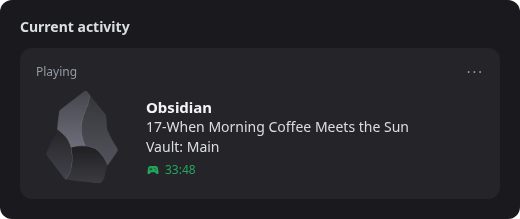

# Vault Presence

Show your vault and current note on Discord with Rich Presence.

Vault Presence connects Obsidian to Discord and displays what you are doing: the name of your vault, the note you have open, and how long you have been working. Everything is configurable, so you decide how much you share.

## Features

- Shows the vault name and the current note in your Discord profile.
- Optional privacy mode that hides file and vault names.
- Custom vault name if you prefer not to reveal the real one.
- Status bar with a Discord icon that shows the connection state quietly: it stays out of your way and adapts to the theme you are using.
- Elapsed time counter, either since startup or live.

## Installation

1. Open Settings, Community plugins.
2. Select Browse and search for "Vault Presence".
3. Install it and enable the plugin.

Discord must be running on your desktop for the connection to work.

## Usage

Once enabled, the plugin connects automatically if "Connect on start" is on. You will see its state in the status bar: click it to connect or disconnect manually. You can also use the commands "Reconnect to Discord" and "Disconnect from Discord" from the command palette.

## Privacy

Everything shown on Discord can be turned off from the plugin settings. With privacy mode enabled, Discord only shows generic text like "Editing Notes" and no file or vault names.

## License

This project is licensed under the [MIT License](LICENSE).

## Credits

Vault Presence is a fork of obsidian-discordrpc by Luke Leppan, who created the original plugin and its base. This fork modernizes the code and continues its maintenance. Full credit for the original project goes to him: https://github.com/lukeleppan/obsidian-discordrpc

